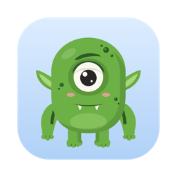
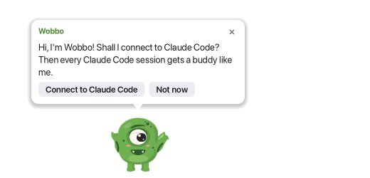

<p align="center">
  
</p>

<h1 align="center">Wobbo</h1>

<p align="center">
  Small Wobbos on your Mac's desktop that show what your Claude Code sessions are doing.<br>
  <a href="https://github.com/timtim32/wobbo/releases/latest"><b>Download the latest release</b></a>
</p>

<p align="center">
  
  <br>
  <sub><a href="docs/images/wobbo-trailer.mp4">Watch the trailer as a video</a></sub>
</p>

## What it is for

When you run several Claude Code sessions at once, you keep switching windows to see which one is thinking, which one is done, and which one is waiting for you. Wobbo puts that on your desktop instead.

- **A Wobbo per session.** Every Claude Code session gets its own little monster, walking along the bottom of your screen, named after its project.
- **Its mood shows the session's state.** It thinks while Claude thinks, picks up a tool while Claude works, and jumps for attention when Claude waits for you. It cheers when the turn is done, looks upset on an error, and falls asleep when the session is idle.
- **Answer without switching windows.** Questions and permission prompts appear in a speech balloon above the Wobbo, with buttons (Allow / Deny, or the answer choices) and a text field.

Wobbo is a hobby project. It is not made or endorsed by Anthropic.

## Install

1. Download **Wobbo.dmg** from the [latest release](https://github.com/timtim32/wobbo/releases/latest) and open it.
2. Drag **Wobbo** onto the **Applications** folder.
3. Open Wobbo from Applications.

**The first time you open it**, macOS stops it, because Wobbo is not notarized by Apple yet:

1. macOS says Wobbo was "Not Opened". Click **Done**.
2. Open **System Settings → Privacy & Security** and scroll down.
3. Next to "Wobbo was blocked to protect your Mac", click **Open Anyway** and confirm.

After that, Wobbo opens like any other app.

**Connect to Claude Code.** Wobbo itself walks in and asks to connect to Claude Code. Click **Connect to Claude Code**. Wobbo finds Claude Code on your Mac and installs its plugin; you don't need a terminal. New sessions then show up as Wobbos.

<p align="center">
  
</p>

**Allow Accessibility (optional).** If your Dock hides automatically, Wobbo asks for Accessibility access so the Wobbos can step aside for it. Allow it under System Settings → Privacy & Security → Accessibility.

## What you can do

- **Click a Wobbo** to bring its session's window to the front.
- **Drag a Wobbo** around, or drop it from up high.
- **Right-click a Wobbo** to send it home.
- **The menu bar icon** has the settings:
  - show or hide the Wobbos;
  - choose the screen they walk on (or follow the mouse);
  - Wobbo size and name labels;
  - how messages reach you: balloons, speech, both, or off, plus notices for "turn finished" and errors;
  - connect or disconnect Claude Code;
  - Open at Login.
- **Claude can talk to you on purpose** with the `say` and `ask_user` tools the plugin adds, for example to tell you that a long task is finished.

## Where it works

| | Status |
|---|---|
| macOS 13 or later | Required |
| Apple silicon | Works; developed and tested here (macOS 27, two displays) |
| Intel Macs | Built in (universal app), but **not yet tested** on an Intel Mac |
| Claude Code in the terminal | Works |
| Claude Code in the Claude desktop app (Code tab) | Works |
| Claude Desktop chats | Only `say` and `ask_user` (Claude Desktop has no hooks), [set up for you](#claude-desktop-chats) |
| Several displays | Works: Wobbos walk from screen to screen |
| Spaces and fullscreen apps | Works: the Wobbos stay visible |
| Windows and Linux | Not supported |
| Other coding agents (Codex, Cursor, …) | Not yet |

## Not there yet

- **Not notarized.** Hence the one-time "Open Anyway" above. Notarization needs a paid Apple Developer account, which this project doesn't have yet.
- **No automatic updates.** To update, download the new Wobbo.dmg and drag Wobbo to Applications again. Wobbo then updates its Claude Code plugin itself and tells you to restart open sessions.
- **Still being checked in this release:**
  - Disconnect from the menu;
  - Open at Login.

  They are built, but not yet confirmed on a release build.
- **Moods.** The Wobbos follow Claude's state, but don't get bored or happy on their own yet.
- **At most five Wobbos.** More sessions take turns: the ones waiting for you come first.

## Privacy

Everything stays on your Mac.

- Wobbo only listens on `127.0.0.1` (your own computer) and checks a secret token that only your user account can read.
- Speech uses the macOS system voice.
- Wobbo itself doesn't send anything over the internet. The only exception is the Claude Code install page, which opens in your browser if you click that button.

## Claude Desktop chats

Claude Desktop has no hooks, so its chats can't show their status, but they can use the `say` and `ask_user` tools. When you connect Wobbo to Claude Code and Claude Desktop is on your Mac, Wobbo adds itself to Claude Desktop too and asks you to restart Claude Desktop. You don't need to edit any file; an entry you added by hand with an older Wobbo is replaced.

## Uninstall

1. Choose **Disconnect from Claude Code** in Wobbo's menu. This removes the plugin from Claude Code and Wobbo's entry from Claude Desktop.
2. Quit Wobbo and move it to the Trash.
3. Optionally delete `~/Library/Application Support/Wobbo`.

## How it works

```
Claude Code ──hooks──▶ wobbo-bridge ──WebSocket (127.0.0.1)──▶ Wobbo app
Claude Desktop ─MCP──▶  (Bun, TS)                              (Godot 4.7 + native macOS)
```

- **The app** (`godot/`) is a Godot 4.7 project: one transparent, click-through
  window per display, with the Wobbos rigged as Skeleton2D characters and
  animated from generated clips.
- **A native extension** (`native/`, Objective-C++) does what Godot can't on
  macOS: show the windows on every Space and above fullscreen apps, hide the
  Dock icon, find the Dock and bring a session's window to the front.
- **The bridge** (`bridge/`, Bun + TypeScript) is a single binary inside a
  Claude Code plugin. Its hooks report each session's state, and its MCP server
  gives Claude the `say` and `ask_user` tools. It talks to the app over a local
  WebSocket with a secret token ([protocol](bridge/PROTOCOL.md)).
- **The artwork** (`art/`) is drawn as layered SVG and exported to rig parts
  by a script.
- **Every feature was planned** as an [OpenSpec](https://github.com/Fission-AI/OpenSpec)
  change: proposal, design decisions and tasks are in [`openspec/`](openspec/).

To build and run it yourself, see [docs/DEVELOPMENT.md](docs/DEVELOPMENT.md).

## Feedback and contributing

Found a bug or have an idea? [Open an issue](https://github.com/timtim32/wobbo/issues).
Pull requests are welcome too; see [CONTRIBUTING.md](CONTRIBUTING.md).

## License

The source code is [MIT licensed](LICENSE). The Wobbo characters, artwork and
name are not: see [ARTWORK.md](ARTWORK.md) for what you may do with them.
